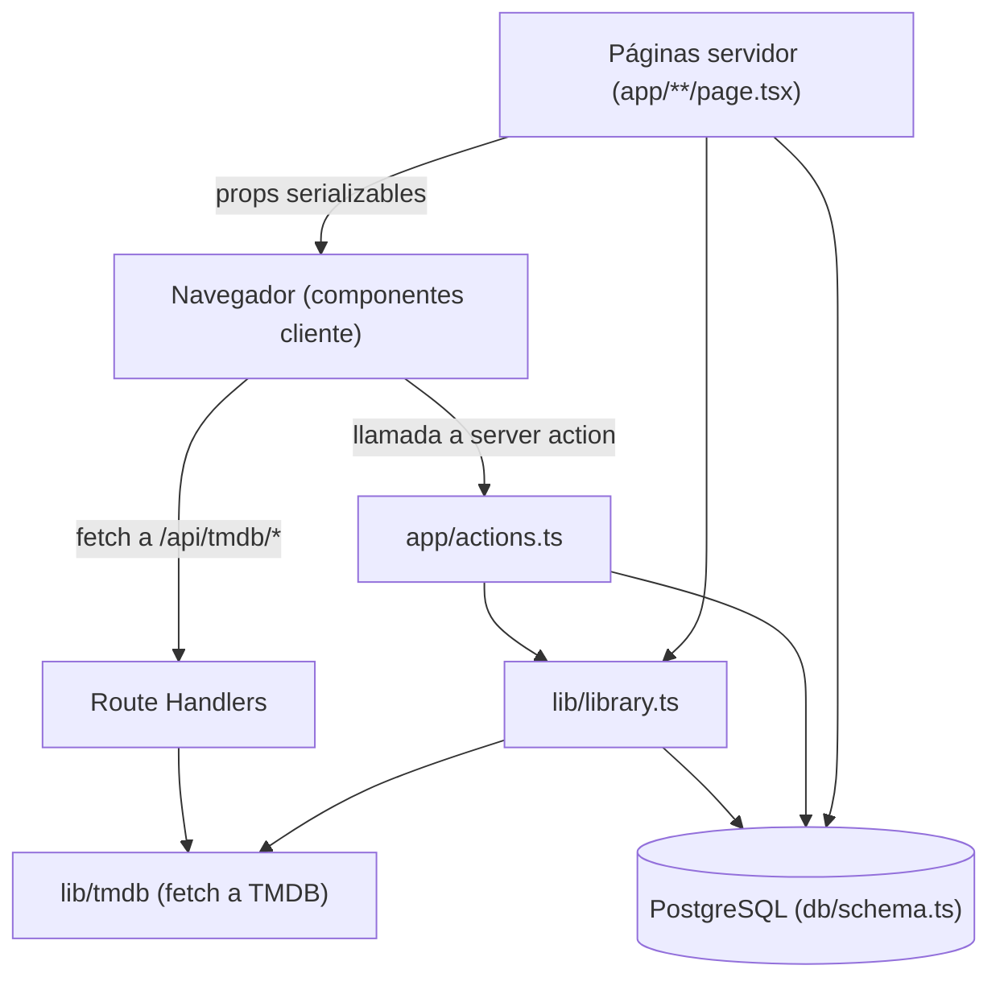

# NeuroMovies — Documentación

Aplicación web personal para llevar el seguimiento de **películas y series**:
qué estás viendo, qué querés ver y qué ya viste, con puntuación de **1 a 5
estrellas** por película y por episodio. Todo el catálogo se obtiene
automáticamente de la **[TMDB API](https://developer.themoviedb.org/docs)**.

La interfaz está en **español**; el código, los nombres de variables y los
commits están en **inglés**.

---

## Índice

1. [Stack y dependencias](#1-stack-y-dependencias)
2. [Cómo ejecutarlo](#2-cómo-ejecutarlo)
3. [Arquitectura general](#3-arquitectura-general)
4. [Recorrido por las páginas](#4-recorrido-por-las-páginas)
5. [Modelo de datos](#5-modelo-de-datos)
6. [Capa TMDB](#6-capa-tmdb)
7. [Lógica de negocio (lib/)](#7-lógica-de-negocio-lib)
8. [Server Actions (app/actions.ts)](#8-server-actions-appactionsts)
9. [Componentes](#9-componentes)
10. [Feature: la Ruleta](#10-feature-la-ruleta)
11. [Feature: Sincronizar todo](#11-feature-sincronizar-todo)
12. [Detalles de Next.js 16 y decisiones técnicas](#12-detalles-de-nextjs-16-y-decisiones-técnicas)
13. [Tests](#13-tests)
14. [Solución de problemas](#14-solución-de-problemas)
15. [Autenticación (login simple)](#15-autenticación-login-simple)
16. [Despliegue en Vercel](#16-despliegue-en-vercel)
17. [Migrar datos desde la SQLite vieja](#17-migrar-datos-desde-la-sqlite-vieja)

---

## 1. Stack y dependencias

| Área          | Tecnología                                                   |
| ------------- | ------------------------------------------------------------ |
| Framework     | **Next.js 16** (App Router, Turbopack, React 19)             |
| Lenguaje      | TypeScript (`strict`)                                        |
| Estilos       | Tailwind CSS v4                                              |
| Base de datos | **PostgreSQL** vía `pg` (node-postgres) + **Drizzle ORM**    |
| Migraciones   | `drizzle-kit` (versionadas en `db/migrations/`)              |
| Fuente de datos | TMDB API v3                                                |
| Tipografía    | Geist, auto-hospedada (`geist/font/*`)                       |
| Tema          | `next-themes` (claro/oscuro)                                 |
| Autenticación | Login propio (contraseña + cookie firmada con HMAC)          |
| Tests         | Vitest                                                       |

Dependencias del `package.json`:

- **Producción:** `next`, `react`, `react-dom`, `drizzle-orm`, `pg`,
  `@vercel/functions`, `@neon/config`, `@neon/env`, `next-themes`, `geist`,
  `server-only`.
- **Desarrollo:** `drizzle-kit`, `vitest`, `vite-tsconfig-paths`, `eslint`,
  `eslint-config-next`, `tailwindcss`, `@tailwindcss/turbopack`, `typescript`,
  `@types/*`.

> `server-only` es un paquete centinela: si un módulo que lo importa llega a un
> componente cliente, el build falla. Así se garantiza que el token de TMDB y el
> acceso a la base de datos nunca viajen al navegador.

---

## 2. Cómo ejecutarlo

### Requisitos
- Node.js ≥ 20.9
- Un **token de TMDB** (gratis)
- Una base **PostgreSQL** (local o en Neon / Vercel)

### Pasos

```bash
cp .env.example .env      # 1. crear el archivo de entorno
# editar .env: pegar TMDB_ACCESS_TOKEN y definir DATABASE_URL

npm install               # 2. instalar dependencias
npm run db:migrate        # 3. aplicar las migraciones a DATABASE_URL
npm run dev               # 4. http://localhost:3000
```

### Variables de entorno

```env
TMDB_ACCESS_TOKEN=eyJhbGciOi...   # obligatorio, solo servidor
TMDB_LANGUAGE=es-MX               # opcional (default es-MX)
DATABASE_URL=postgresql://...     # obligatorio (o POSTGRES_URL)
APP_PASSWORD=...                  # opcional: si falta, no se pide login
AUTH_SECRET=...                   # opcional: firma la cookie (default: APP_PASSWORD)
```

### Scripts

| Script                      | Qué hace                                         |
| --------------------------- | ------------------------------------------------ |
| `npm run dev`               | Servidor de desarrollo                           |
| `npm run build`             | Build de producción                              |
| `npm run start`             | Sirve el build de producción                     |
| `npm run lint`              | ESLint                                           |
| `npm run typecheck`         | `tsc --noEmit`                                   |
| `npm test`                  | Tests unitarios (Vitest)                         |
| `npm run db:generate`       | Genera una migración a partir del schema         |
| `npm run db:migrate`        | Aplica migraciones pendientes a `DATABASE_URL`   |
| `npm run db:import-sqlite`  | Importa datos de un `data/app.db` viejo          |

`.env` y `data/` (la base SQLite vieja) están **en `.gitignore`**.

---

## 3. Arquitectura general

La app sigue el modelo de **App Router** de Next.js, con una separación clara
entre lo que corre en el **servidor** y lo que corre en el **cliente**.



**Reglas de oro del proyecto:**

- **TMDB solo del lado servidor.** El token vive en `lib/tmdb/client.ts`, que
  lleva `import "server-only"`. El navegador nunca lo ve.
- **Lecturas y escrituras a la base: solo en servidor.** Los componentes
  cliente no importan `@/db`; piden datos por props (ya renderizados en el
  servidor) o llaman **server actions**.
- **Las props servidor → cliente deben ser serializables.** Por eso, por
  ejemplo, el progreso de episodios se pasa como `Record<number, { watched, rating }>`
  y no como objetos de Drizzle.
- **Render por request.** Las páginas que leen la base llaman a
  `await connection()` y declaran `export const instant = false` para salir del
  prerender estático (ver §12).
- **Autenticación en dos capas.** `proxy.ts` hace un chequeo optimista (cookie) y
  cada Server Action vuelve a verificar la sesión antes de escribir (ver §15).

### Árbol de carpetas

```
app/                         Rutas y páginas (App Router)
  actions.ts                 Server Actions (mutaciones)
  auth-actions.ts            Server Actions de login/logout
  api/tmdb/{search,trending,popular}/route.ts   Route Handlers (proxy a TMDB)
  buscar/page.tsx            Búsqueda en TMDB
  biblioteca/page.tsx        Biblioteca + ruleta + "sincronizar todo"
  login/page.tsx             Pantalla de inicio de sesión
  pelicula/[tmdbId]/page.tsx Ficha de película
  serie/[tmdbId]/page.tsx    Ficha de serie
  configuracion/page.tsx     Estado del token y de la base
  layout.tsx, manifest.ts, globals.css
proxy.ts                     Puerta de autenticación (ex middleware)
components/                  Componentes React
  home/                      Secciones del inicio
  library/                   Grilla, ruleta, botón de sync
  movie/, series/            Fichas
  search/                    Buscador y resultados
  layout/                    Nav (con "Salir") y footer
  tmdb/                      Atribución y guía de setup
  ui/                        Primitivos (estrellas, toasts, tema, empty state)
db/
  schema.ts                  Definición de tablas (Drizzle, pg-core)
  index.ts                   Conexión a PostgreSQL (lazy, vía pg + Vercel Fluid)
  migrations/                SQL versionado
lib/
  auth.ts                    Firma/verificación de la cookie de sesión (HMAC)
  session.ts                 isAuthenticated() para Server Actions
  library.ts                 Caché/refresh de títulos + queries de biblioteca
  library-types.ts           Tipos de vista + etiquetas
  tmdb/client.ts             Cliente HTTP (retry, límite de concurrencia)
  tmdb/api.ts                Endpoints de TMDB
  tmdb/transform.ts          Normalización de respuestas
  tmdb/types.ts              Tipos crudos de TMDB + "drafts"
  tmdb/images.ts             URLs de imágenes
  progress.ts                Reglas de progreso/emisión
  refresh.ts                 Ventanas de refresco
  validate.ts                Validación de puntuaciones
  roulette.ts                Sorteo aleatorio (ruleta)
  utils.ts                   Helpers (fechas, runtime, cn)
scripts/
  migrate-sqlite-to-pg.mjs   Importa datos de la SQLite vieja a PostgreSQL
tests/                       Tests unitarios (Vitest)
```

---

## 4. Recorrido por las páginas

### 4.1 Inicio — `/` (`app/page.tsx`)

Página **servidor**. Lee la biblioteca completa y arma las secciones:

- **Continuar viendo:** series en estado `watching` que tienen un episodio
  emitido pendiente (`getContinueWatching`). Cada ítem tiene un botón
  "Marcar visto".
- **Quiero ver:** hasta 6 ítems en estado `wishlist`.
- **Vistas recientes:** hasta 6 ítems `watched`, ordenados por fecha de visto.
- **Tendencias en TMDB:** componente cliente que pide `/api/tmdb/trending`.

Usa `await connection()` y `export const instant = false` para renderizar por
request (ver §12).

### 4.2 Buscar — `/buscar` (`app/buscar/page.tsx`)

Página **cliente**. Tiene búsqueda en vivo con *debounce* de 300 ms. Llama a
`/api/tmdb/search` y renderiza `SearchResults`, que permite agregar cada
resultado a la biblioteca ("Quiero ver" o "Viendo") llamando al server action
`addToLibrary`.

### 4.3 Biblioteca — `/biblioteca` (`app/biblioteca/page.tsx`)

Página **servidor** que:

1. Trae todos los ítems con `getLibraryItems()`.
2. Calcula cuántas series conoce la app (`countTvTitles`) para mostrar u
   ocultar el botón **Sincronizar todo**.
3. Filtra las **películas en "Quiero ver"** y, si hay al menos una, muestra la
   **Ruleta**.
4. Renderiza `LibraryGrid`: una grilla cliente con filtros (tipo, estado,
   puntuación mínima, búsqueda) y orden (agregado, título, puntuación).

### 4.4 Ficha de película — `/pelicula/[tmdbId]` (`app/pelicula/[tmdbId]/page.tsx`)

Página **servidor**:

1. `ensureTitle(id, "movie")` — devuelve el título cacheado o lo baja de TMDB y
   lo guarda.
2. Busca la entrada de biblioteca (`libraryEntries`), si existe.
3. `refreshTitleIfStale(...)` — re-sincroniza si pasó la ventana de refresco.
4. Renderiza `MovieDetail` (cliente) con:

   - Póster + backdrop, título original, sinopsis.
   - **Puntuación** con estrellas (`setMovieRating`; una puntuación distinta de
     `null` marca la película como `watched` y le pone fecha).
   - **Estado** (`updateLibraryStatus`).
   - **Fecha en que la vi** (`setMovieWatchedAt`).
   - **Nota personal** (`updateLibraryNotes`).

### 4.5 Ficha de serie — `/serie/[tmdbId]` (`app/serie/[tmdbId]/page.tsx`)

Página **servidor**:

1. `ensureTitle(id, "tv")` — cachea la serie **y todos sus episodios**.
2. `refreshTitleIfStale(...)` — ventana de 24 h si está "Viendo", 30 días si no.
3. Carga temporadas, episodios y el progreso de cada episodio.
4. Arma `progress` como `Record<episodeId, { watched, rating }>` (serializable)
   y renderiza `SerieDetail` (cliente).

`SerieDetail` permite:

- Elegir temporada por pestañas (los **especiales — temporada 0 —** se ocultan
  por defecto y **no cuentan** para el progreso).
- Ver el **promedio** de la serie y de cada temporada (calculado a partir de las
  puntuaciones de los episodios; la serie no tiene puntuación propia).
- **Puntuar** un episodio (lo marca visto) y **marcar/desmarcar** un episodio.
- **"Hasta aquí"**: marcar como vistos todos los emitidos hasta ese episodio
  (`markUpToEpisodeWatched`).
- **Marcar/desmarcar la temporada completa** (`setSeasonWatched`).
- `próximamente` para episodios aún no emitidos (no se pueden marcar).
- Badge **"Al día"** cuando vio todos los emitidos y la serie puede seguir
  emitiendo.

### 4.6 Configuración — `/configuracion` (`app/configuracion/page.tsx`)

Página **servidor**. Muestra si `DATABASE_URL` y el token de TMDB están
configurados; si falta el token, además muestra una guía paso a paso
(`SetupGuide`).

### 4.7 Login — `/login` (`app/login/page.tsx`)

Pantalla de inicio de sesión (ver §15). Formulario con `useActionState`; al
acertar la contraseña, guarda la cookie de sesión y redirige a `next` (o a `/`).

### 4.8 Manifiesto PWA — `/manifest.webmanifest` (`app/manifest.ts`)

Devuelve el manifest para que la app se pueda "instalar" como PWA.

---

## 5. Modelo de datos

Cinco tablas en `db/schema.ts`, con borrado en cascada desde `titles`.

```mermaid
erDiagram
  titles ||--o{ seasons : "tiene"
  titles ||--o{ episodes : "tiene"
  seasons ||--o{ episodes : "agrupa"
  titles ||--o| library_entries : "entrada"
  episodes ||--o| episode_progress : "progreso"

  titles {
    int id PK
    int tmdb_id
    text media_type "movie | tv"
    text title
    text poster_path
    text backdrop_path
    text release_date
    text first_air_date
    json genres
    text tmdb_status
    timestamp last_synced_at
  }
  seasons {
    int id PK
    int title_id FK
    int season_number
    text name
    int episode_count
    text air_date
  }
  episodes {
    int id PK
    int title_id FK
    int season_id FK
    int tmdb_id
    int season_number
    int episode_number
    text name
    text air_date
    int runtime
    text still_path
  }
  library_entries {
    int title_id PK
    text status "wishlist|watching|watched|abandoned"
    int rating "1..5 (películas)"
    timestamp watched_at
    timestamp added_at
    text notes
  }
  episode_progress {
    int episode_id PK
    boolean watched
    timestamp watched_at
    int rating "1..5"
  }
}
```

### Notas

- **`titles`** guarda el caché de TMDB. `genres` se guarda como JSON.
  `last_synced_at` controla el refresco.
- **`library_entries`** es la pertenencia a la biblioteca: su clave primaria es
  `title_id`, o sea **una entrada por título**. `status` es un enum; `rating`
  solo se usa en películas (las series derivan su promedio de los episodios).
- **`episode_progress`** es la clave primaria `episode_id`: una fila por
  episodio con progreso. Guarda `watched` y `rating`.
- **Constraints (`CHECK`):** las puntuaciones deben ser `NULL` o estar entre 1 y
  5, tanto en `library_entries` como en `episode_progress`. La validación en
  código (`parseRating`) es el espejo de estos constraints en la base.
- **Índices únicos en `titles`:** `(tmdb_id, media_type)` y también `tmdb_id`
  solo. El segundo significa que un `tmdb_id` no puede repetirse aunque cambie
  el tipo.
- **Borrado en cascada:** borrar un `title` elimina sus temporadas, episodios,
  entradas y progreso.

### Conexión (`db/index.ts`)

- Lleva `import "server-only"`.
- Usa **`pg` (node-postgres)** con un *pool* TCP (`Pool`). Es el método recomendado
  en **Vercel Fluid compute**: la conexión se establece una vez y se reutiliza
  entre requests. El `sslmode=require` de la URL de Neon lo interpreta el driver.
- Llama a **`attachDatabasePool`** (`@vercel/functions`) justo después de crear el
  pool: en Vercel, cierra las conexiones ociosas antes de suspender la función.
  Fuera de Vercel (desarrollo local) es un no-op.
- **Se crea de forma perezosa** (un `Proxy`): importar el módulo no se conecta, así
  el build no falla si falta `DATABASE_URL`. Si se usa la base sin configurarla,
  lanza un error claro.
- Mantiene **una sola instancia** entre hot reloads en desarrollo (la cuelga de
  `globalThis`).
- Acepta `DATABASE_URL` o `POSTGRES_URL` (la que inyecta la integración de Vercel/Neon).
- Exporta `hasDatabaseUrl()`, que usa la página de configuración.

> Las **migraciones** (`npm run db:migrate`) y la **importación** usan la conexión
> **directa** (`DATABASE_URL_UNPOOLED`) cuando está disponible, porque el *pooler*
> de transacciones no está pensado para DDL ni para sesiones largas. La app, en
> cambio, usa la **pooled** (`DATABASE_URL`).

---

## 6. Capa TMDB

### 6.1 Cliente HTTP — `lib/tmdb/client.ts`

Envoltorio de `fetch` con `server-only`:

- **Autenticación:** `Authorization: Bearer <TMDB_ACCESS_TOKEN>`.
- **Reintentos** con *backoff* exponencial + *jitter* (máx. 8 s) ante:
  - HTTP **429** (respeta el header `Retry-After`),
  - HTTP **5xx**,
  - errores de red.
  - Máximo 3 reintentos.
- **Límite de concurrencia** con un semáforo (`MAX_CONCURRENCY = 4`).
- Lanza errores tipados: `TmdbMissingTokenError`, `TmdbHttpError`,
  `TmdbNetworkError`.
- `hasTmdbToken()` y `getTmdbLanguage()` leen el entorno.

### 6.2 Endpoints — `lib/tmdb/api.ts`

- `searchMulti(q)` → `/search/multi` (descarta personas, `include_adult=false`).
- `getTrending(period)` → `/trending/all/{day|week}`.
- `getPopular(movie|tv)` → `/movie/popular` o `/tv/popular`.
- `getMovieDetail(id)`, `getTvDetail(id)`, `getSeasonDetail(tvId, n)`.
- Fábricas de *drafts* usadas por la persistencia:
  `fetchMovieDraft`, `fetchTvBundle` (título + temporadas), `fetchSeasonEpisodes`.

**Localización con respaldo:** `localize()` pide primero en el idioma
configurado y, si algún campo clave (título/sinopsis) viene vacío, vuelve a
pedirlo en `en-US` y **rellena solo los campos faltantes** (`fillMissing`). Esto
minimiza requests.

### 6.3 Transformación — `lib/tmdb/transform.ts`

Convierte las respuestas crudas de TMDB (`Tmdb*`) en **drafts** normalizados
(`TitleDraft`, `SeasonDraft`, `EpisodeDraft`, `SearchEntry`). Normaliza cadenas
vacías a `null` (`fallbackToNull`).

### 6.4 Imágenes — `lib/tmdb/images.ts`

Construye URLs a `image.tmdb.org` con distintos tamaños:

- `posterUrl` (grillas `w342`, fichas `w780`),
- `backdropUrl` (`w780`),
- `stillUrl` (fotos de episodios, `w342`).

`next.config.ts` autoriza el host `image.tmdb.org` en `images.remotePatterns`.

### 6.5 Route Handlers

En `app/api/tmdb/` exponen al navegador tres endpoints controlados:

| Ruta                     | Query           | Devuelve                    |
| ------------------------ | --------------- | --------------------------- |
| `/api/tmdb/search`       | `q`, `limit`    | Resultados de búsqueda      |
| `/api/tmdb/trending`     | `period`, `limit` | Tendencias                |
| `/api/tmdb/popular`      | `type`, `limit` | Populares (movie/tv)        |

Todos responden `400 { error: "missing-token" }` si falta el token, y traducen
`TmdbHttpError` a su status. Así, el token y la lógica de reintentos quedan en
el servidor y el cliente solo consume JSON.

---

## 7. Lógica de negocio (lib/)

### 7.1 `lib/progress.ts` — reglas de progreso

- `isAired(airDate, today?)`: ¿ya se emitió? (si falta o es inválida, `false`).
- `calculateProgress({...})`: porcentaje vistos/emitidos, acotado a `[0,1]`.
- `averageSeasonRating` / `averageSeriesRating`: promedio redondeado a 1 decimal
  de las puntuaciones no nulas.
- `shouldHideSpecials()` y `countsTowardProgress(n)`: los **especiales
  (temporada 0)** no cuentan.
- `isReturningSeries(status)`: si la serie puede seguir emitiendo (busca
  "returning", "in production", "ongoing", "airing") para decidir si terminarla
  la deja como "Vista" o "Al día".

### 7.2 `lib/refresh.ts` — ventanas de refresco

- `REFRESH_WATCHING_MS = 24 h`, `REFRESH_DEFAULT_MS = 30 días`.
- `isStale(lastSyncedAt, status, now?)`: `true` si nunca se sincronizó o si
  pasó la ventana. Las series "Viendo" refrescan seguido; el resto, cada 30 días
  (los términos de TMDB piden refrescar dentro de los 6 meses).

### 7.3 `lib/validate.ts` — validación de puntuaciones

`parseRating(value)`:
- `null` / `undefined` / `""` → `null` (borra la puntuación).
- Entero 1–5 → el número.
- Cualquier otra cosa (0, 6, 1.5, `"abc"`) → lanza `RatingValidationError`.

### 7.4 `lib/roulette.ts` — sorteo de la ruleta

`pickRandomIndex(length, avoidIndex?, random = Math.random)`:
- `length <= 0` → `-1`.
- Devuelve un índice en `[0, length)`.
- Si hay más de una opción, **nunca** devuelve `avoidIndex` (evita repetir la
  última elegida).
- `random` es inyectable para poder testearlo.

### 7.5 `lib/library.ts` — caché, refresco y consultas

Módulo central con `server-only`. Se encarga de **mantener sincronizado el
caché de TMDB** y de armar las vistas.

**Caché y sincronización**

- `ensureTitle(tmdbId, mediaType)`: devuelve el título cacheado o lo baja de
  TMDB y lo guarda. Tolera condiciones de carrera (dos requests insertando el
  mismo título) releyendo si el insert choca con el índice único.
- `cacheTitleFromTmdb`: para **película** guarda el título; para **serie** baja
  el *bundle* (título + temporadas) y sincroniza **todos los episodios**.
- `syncTvChildren(titleId, tvId, drafts)`: hace *upsert* de las temporadas y
  baja los episodios de cada temporada cuyo conteo cambió. Devuelve **cuántas
  temporadas fallaron**.
- `refreshTitleIfStale(title, status)`: si el caché está *stale*, lo vuelve a
  bajar. **Nunca lanza**: ante un fallo de TMDB sigue sirviendo el caché.
- **Robustez:** si una temporada no se pudo bajar, `last_synced_at` queda en
  `null` para que se reintente en la próxima visita (así no se "congela" un
  caché incompleto). Esto corrige el caso de series con episodios faltantes.
- `syncAllLibrarySeries()`: recorre **todas las series conocidas** (de la
  biblioteca y las cacheadas al navegar) y fuerza el refresco completo. Devuelve
  un resumen (`total`, `sincronizadas`, `fallidas`, `episodios nuevos`).
- `countTvTitles()`: cuántas series conoce la app.

**Consultas de biblioteca**

- `getLibraryItems()`: devuelve `LibraryItem[]` con datos derivados:
  - para **películas**: su puntuación y estado,
  - para **series**: el **promedio de puntuaciones de episodios**, el
    **progreso** (vistos/emitidos, sin especiales) y la marca `upToDate`.
- `getContinueWatching()`: series en `watching` con el **próximo episodio
  emitido y no visto** (ignora especiales; excluye las que están al día).

### 7.6 `lib/library-types.ts`

Tipos de vista (`LibraryItem`, `ContinueWatchingItem`, `TvProgress`) y las
etiquetas/opciones de UI: `STATUS_LABEL` (Quiero ver / Viendo / Vista /
Abandonada), `LIBRARY_SORT_LABEL`, filtros y orden.

---

## 8. Server Actions (`app/actions.ts`)

Archivo con `"use server"`. Cada acción muta la base y **revalida** las rutas
afectadas (`revalidatePath`). Devuelven `{ ok: true }` o `{ ok: false, error }`.

Todas empiezan verificando la sesión (`isAuthenticated()` de `lib/session.ts`); si
no hay sesión válida devuelven `UNAUTHORIZED`. El login y el logout viven aparte,
en `app/auth-actions.ts`.

| Acción | Qué hace |
| ------ | -------- |
| `setMovieRating(titleId, rating)` | Puntúa una película. Puntuación no nula ⇒ pasa a `watched` con fecha. |
| `updateLibraryStatus(titleId, status)` | Cambia el estado (crea la entrada si no existe). |
| `updateLibraryNotes(titleId, notes)` | Guarda/borra la nota personal. |
| `setMovieWatchedAt(titleId, date)` | Fija la fecha en que se vio. |
| `addToLibrary(tmdbId, mediaType, status)` | Cachea el título vía `ensureTitle` y lo agrega a la biblioteca. |
| `syncAllSeries()` | Fuerza la sincronización de todas las series (ver §11). |
| `setEpisodeProgress(episodeId, patch)` | Marca visto / puntúa un episodio. |
| `setSeasonWatched(titleId, season, watched)` | Marca/desmarca una temporada completa (solo episodios emitidos). |
| `markUpToEpisodeWatched(episodeId)` | Marca como vistos todos los emitidos hasta ese episodio. |

### Invariantes importantes

- **Una puntuación implica visto.** Puntuar un episodio lo marca visto;
  desmarcar "visto" borra la puntuación.
- **No se puede marcar un episodio no emitido** (`isAiredDate`).
- `setSeasonWatched` y `markUpToEpisodeWatched` operan **solo sobre episodios
  emitidos**.
- **Helpers internos:**
  - `ensureStartedEntry(titleId)`: pasar un episodio a visto asegura que la
    serie esté en `watching` (si estaba en `wishlist`/`abandoned`, la pasa a
    "Viendo").
  - `recomputeSeriesStatus(titleId)`: recalcula el estado de la serie:
    - todos los emitidos vistos + serie **terminada** ⇒ `watched`;
    - todos los emitidos vistos + serie **en emisión** ⇒ `watching` ("Al día");
    - algunos vistos ⇒ `watching`.

---

## 9. Componentes

### Estructura

- **`components/ui/`**
  - `star-rating.tsx`: control 1–5 con teclado y accesibilidad. Click en la
    misma estrella borra; hover/focus previsualiza; roles `radiogroup`/`radio`.
  - `toast-provider.tsx`: contexto `useToast()` + contenedor de avisos con
    `aria-live`.
  - `theme-provider.tsx` / `theme-toggle.tsx`: tema claro/oscuro con
    `next-themes` (el toggle evita desajustes de hidratación con
    `useSyncExternalStore`).
  - `empty-state.tsx`: bloque vacío reutilizable.
- **`components/layout/`**: `nav.tsx` (barra superior fija con navegación, botón
  "Salir" cuando hay login, y toggle de tema), `logout-button.tsx` y `footer.tsx`
  (incluye la atribución a TMDB).
- **`components/home/`**: `continue-watching.tsx`, `poster-row.tsx`,
  `trending-section.tsx`, `home-skeleton.tsx`.
- **`components/library/`**: `library-grid.tsx`, `wishlist-roulette.tsx`,
  `sync-all-button.tsx`.
- **`components/movie/`**: `movie-detail.tsx`.
- **`components/series/`**: `serie-detail.tsx`.
- **`components/search/`**: `search-box.tsx`, `search-results.tsx`.
- **`components/tmdb/`**: `tmdb-attribution.tsx`, `setup-guide.tsx`.

### Patrón de mutación en componentes cliente

Casi todos los componentes interactivos siguen este patrón (por ejemplo
`ContinueWatching`):

```tsx
const [pending, setPending] = useState(false);
const handle = async () => {
  setPending(true);
  const result = await setEpisodeProgress(id, { watched: true }); // server action
  setPending(false);
  if (!result.ok) showToast(result.error ?? "No se pudo guardar");
};
```

`SerieDetail` va un paso más allá: aplica el cambio **de forma optimista** al
estado local (`applyLocal`), guarda un `snapshot` y **restaura** si la acción
falla.

---

## 10. Feature: la Ruleta

**Objetivo:** cuando no sabés qué película ver, que la app elija una al azar de
tu lista **"Quiero ver"**.

**Dónde:** en `/biblioteca`, arriba de la grilla. Solo aparece si hay al menos
una película en "Quiero ver".

**Cómo funciona** (`components/library/wishlist-roulette.tsx`, cliente):

1. Recibe por props `items` ya filtrados por la página a **películas** en
   estado **`wishlist`** (`mediaType === "movie" && status === "wishlist"`).
2. Estado: `phase` (`idle` | `spinning` | `result`), `displayIndex`,
   `chosenIndex`.
3. Al hacer "Elegir al azar":
   - Calcula el objetivo con `pickRandomIndex(items.length, chosenIndex)` (no
     repite la anterior si hay más de una).
   - Durante ~**1,1 s** cambia el póster cada ~90 ms (animación de "giro").
   - Al terminar fija el índice elegido y muestra título (año), póster, enlace
     **"Ver ficha"** y botón **"Girar de nuevo"**.
4. El resultado se anuncia con `aria-live="polite"`.
5. Limpia los timers al desmontar (`useEffect`).

La lógica de sorteo vive en `lib/roulette.ts` (`pickRandomIndex`) y tiene tests
unitarios, para que la aleatoriedad sea verificable sin depender de la UI.

> Nota: gira siempre sobre **todas** las películas de "Quiero ver",
> independientemente de los filtros que tengas aplicados en la grilla.

---

## 11. Feature: Sincronizar todo

**Objetivo:** bajar/actualizar **de una sola vez** todas las temporadas y
episodios de todas las series, para reparar cachés incompletos.

**Dónde:** botón en el header de `/biblioteca` (`SyncAllButton`), visible si la
app conoce alguna serie.

**Flujo:**

1. El botón (cliente) llama al server action `syncAllSeries()`.
2. `syncAllSeries()` verifica el token y llama a `syncAllLibrarySeries()`.
3. `syncAllLibrarySeries()` recorre **todas las series** (de la biblioteca y las
   cacheadas) y, para cada una, baja el *bundle* y re-sincroniza temporadas y
   episodios. Si una serie falla, se cuenta y se sigue con la próxima.
4. Se revalidan `/`, `/biblioteca` y cada `/serie/{tmdbId}` sincronizada.
5. El botón muestra un *toast* con el resumen: `"Listo: N series al día, M
   episodios nuevos."` o `"Sincronizadas X de N series (Y con error)."`.

**Por qué es robusto:** como `syncTvChildren` informa las temporadas fallidas,
una sincronización parcial **no** se marca como completa (`last_synced_at =
null`), y se reintenta sola en la próxima visita o en el próximo clic. Repetir
el botón es idempotente cuando ya está todo al día.

---

## 12. Detalles de Next.js 16 y decisiones técnicas

Este proyecto usa un Next.js con **cambios importantes** respecto de versiones
anteriores. Puntos a tener en cuenta:

- **Cache Components.** `next.config.ts` activa `cacheComponents: true` y
  `partialPrefetching: true`. En este modo **no** se usa
  `export const dynamic = "force-dynamic"`.
- **Render por request.** Las páginas que leen la base llaman a `await connection()`
  de `next/server` y declaran `export const instant = false` para salir del
  prerender estático. Están en `/`, `/biblioteca`, `/configuracion`,
  `/pelicula/[tmdbId]` y `/serie/[tmdbId]`. La de `/login` usa `instant = false`
  porque lee `searchParams`.
- **`proxy.ts` (ex `middleware`).** En Next 16 *middleware* se renombró a *proxy*;
  la función exportada se llama `proxy`. Corre por defecto en runtime Node, así que
  puede firmar/verificar la cookie de sesión.
- **`LayoutProps<"/">`.** El layout raíz tipa sus props con el tipo global
  `LayoutProps`, que solo existe **después** de que Next genera los tipos en
  `.next`. Por eso conviene correr `next build` antes de un `tsc` suelto tras
  borrar `.next`.
- **`serverExternalPackages`.** `postgres` y `drizzle-orm` se marcan como externos
  para no bundlearlos en el servidor.
- **Imágenes.** `images.remotePatterns` autoriza `image.tmdb.org`.
- **Turbopack + Tailwind v4.** `next.config.ts` registra el loader
  `@tailwindcss/turbopack` para CSS.
- **Fuentes:** Geist se auto-hospeda con el paquete `geist`
  (`geist/font/sans`, `geist/font/mono`), sin depender de Google Fonts en el
  build.
- **PWA:** `app/manifest.ts` expone el manifest; el `themeColor` se define en
  `app/layout.tsx` (`viewport`).
- **`AGENTS.md`** es un bloque que `next dev` **regenera** automáticamente;
  conviene commitearlo con el trabajo para no dejar cambios sin guardar.

### Estilos y tema

Tailwind v4 con variables CSS (`app/globals.css`): `--background`/`--foreground`
para claro y oscuro, y `@custom-variant dark` para las clases `dark:`. El tema
por defecto es **oscuro**.

---

## 13. Tests

Vitest (entorno `node`, `vite-tsconfig-paths`). Se concentran en la **lógica
pura**, sin base de datos ni red.

| Archivo | Cubre |
| ------- | ----- |
| `tests/progress.test.ts` | `isAired`, `calculateProgress`, promedios, `isReturningSeries` |
| `tests/refresh.test.ts` | `isStale` y ventanas de refresco |
| `tests/roulette.test.ts` | `pickRandomIndex` (rango, evitar repetir, casos borde) |
| `tests/tmdb-transform.test.ts` | Normalización de respuestas de TMDB |
| `tests/validate.test.ts` | `parseRating` |
| `tests/auth.test.ts` | Firma/verificación de sesión, `verifyPassword`, `safeNextPath` |

```bash
npm test        # 60 tests
```

---

## 14. Solución de problemas

- **"Falta configurar TMDB_ACCESS_TOKEN":** creá `.env` con el token (ver §2) y
  **reiniciá el servidor** (las variables de entorno se leen al arrancar).
- **No se ven las imágenes:** `next/image` descarga desde `image.tmdb.org`, que
  requiere conexión a internet en tiempo de ejecución.
- **Errores raros de módulos / tipos tras borrar `.next`:** corré
  `rm -rf .next` y luego `npm run build` (regenera los tipos), y recién después
  `npm run typecheck`.
- **Series con episodios faltantes:** usá **Sincronizar todo** en la biblioteca;
  reintenta lo que haya fallado.
- **La base:** es PostgreSQL y se configura con `DATABASE_URL`. Para aplicar el
  esquema: `npm run db:migrate` (usa `DATABASE_URL_UNPOOLED` si existe). Si
  migraste desde la versión SQLite: `npm run db:import-sqlite`.
- **"Falta configurar DATABASE_URL":** la app no puede conectarse. Definí
  `DATABASE_URL` (o `POSTGRES_URL`) en `.env` y reiniciá.
- **Login no pedido en local:** es a propósito; se activa al definir `APP_PASSWORD`.
- **Login no funciona en la web:** la cookie usa `secure`, así que requiere HTTPS
  (Vercel lo da por defecto). Definí también `AUTH_SECRET`.

---

## 15. Autenticación (login simple)

Login de **un solo usuario**, sin tabla de sesiones:

- `lib/auth.ts` (sin `server-only`, para poder usarse también en `proxy.ts`):
  - `isAuthEnabled()`: hay login solo si `APP_PASSWORD` está definido.
  - `verifyPassword(input)`: compara en tiempo constante contra `APP_PASSWORD`.
  - `createSessionToken()` / `verifySessionToken()`: token `"<expiración>.<hmac>"`,
    firmado con HMAC-SHA256 (Web Crypto) usando `AUTH_SECRET` (o `APP_PASSWORD`).
    Vale 30 días.
  - `safeNextPath()`: evita *open redirects* al volver tras el login.
- `proxy.ts`: si hay auth y no hay cookie válida, redirige a `/login?next=...`.
  Si ya hay sesión y se entra a `/login`, redirige a `/`.
- `app/login/page.tsx` + `login-form.tsx`: formulario (`useActionState`).
- `app/auth-actions.ts`: `login` (valida y setea la cookie) y `logout`.
- `lib/session.ts`: `isAuthenticated()`, usada por cada Server Action.
- La cookie es `httpOnly`, `sameSite=lax`, `secure` en producción, `path=/`.

Si `APP_PASSWORD` está vacío, todo el esquema de auth queda inactivo: no hay
redirecciones ni verificación (modo desarrollo).

---

## 16. Despliegue en Vercel

1. Subí el repo a GitHub e importalo en Vercel.
2. Creá PostgreSQL (por ejemplo, la integración de **Neon**) y asegurate de tener
   `DATABASE_URL` (o `POSTGRES_URL`).
3. Definí `TMDB_ACCESS_TOKEN`, `APP_PASSWORD` y `AUTH_SECRET` como Environment
   Variables.
4. Aplicá migraciones contra esa base (idealmente con la URL **directa**, sin
   `-pooler`): `DATABASE_URL_UNPOOLED="postgresql://..." npm run db:migrate`.
5. Deploy.

La app se conecta con **`pg` (node-postgres) + pool**, y llama a
`attachDatabasePool` de `@vercel/functions`. En Vercel Fluid compute eso mantiene
la conexión TCP caliente y reutilizable entre requests (el método más rápido una
vez establecida la conexión). Por eso conviene dejar la variable `DATABASE_URL`
apuntando al endpoint **`-pooler`**.

Por qué no SQLite: en Vercel el filesystem es efímero y de solo lectura; una base
en archivo no persiste ni admite escrituras concurrentes.

### 16.1 Setup con la CLI de Neon (`neon init` / `neon deploy`)

Este repo se configuró con la CLI de Neon:

```bash
npm i -g neon@latest
neon login
neon init -y --org-id <org> --project-id <proyecto> --branch production --services postgres
neon deploy
```

`neon init` deja:

- `neon.ts` — política de ramas/servicios (se versiona).
- `.neon` — vínculo al proyecto/rama (está en `.gitignore`).
- Variables en `.env`: `DATABASE_URL` (pooled), `DATABASE_URL_UNPOOLED` (directa) y
  `NEON_BRANCH`.
- Skills de Neon y el MCP para agentes.

---

## 17. Migrar datos desde la SQLite vieja

`scripts/migrate-sqlite-to-pg.mjs` (script `npm run db:import-sqlite`) lee
`data/app.db` con el módulo nativo `node:sqlite` y copia todo a PostgreSQL. Carga
`.env` por su cuenta y prefiere `DATABASE_URL_UNPOOLED` (conexión directa):

```bash
npm run db:import-sqlite
# o, para pisar una base que ya tenga datos:
npm run db:import-sqlite -- --force
```

Convierte `genres` (texto JSON → `jsonb`), los enteros de milisegundos →
`timestamp with time zone` y `watched` (0/1) → `boolean`; conserva los `id` y
realinea las secuencias `serial` con `setval`.

---

## Apéndice: cheatsheet de rutas

| Ruta | Tipo | Descripción |
| ---- | ---- | ----------- |
| `/` | Dinámica (ƒ) | Inicio con secciones |
| `/buscar` | Estática | Búsqueda en TMDB |
| `/biblioteca` | Dinámica (ƒ) | Biblioteca + ruleta + sync |
| `/login` | Dinámica (ƒ) | Inicio de sesión |
| `/pelicula/[tmdbId]` | Partial Prerender (◐) | Ficha de película |
| `/serie/[tmdbId]` | Partial Prerender (◐) | Ficha de serie |
| `/configuracion` | Dinámica (ƒ) | Estado del token y de la base |
| `/manifest.webmanifest` | Estática | Manifest PWA |
| `/api/tmdb/search` | Dinámica | Búsqueda |
| `/api/tmdb/trending` | Dinámica | Tendencias |
| `/api/tmdb/popular` | Dinámica | Populares |
